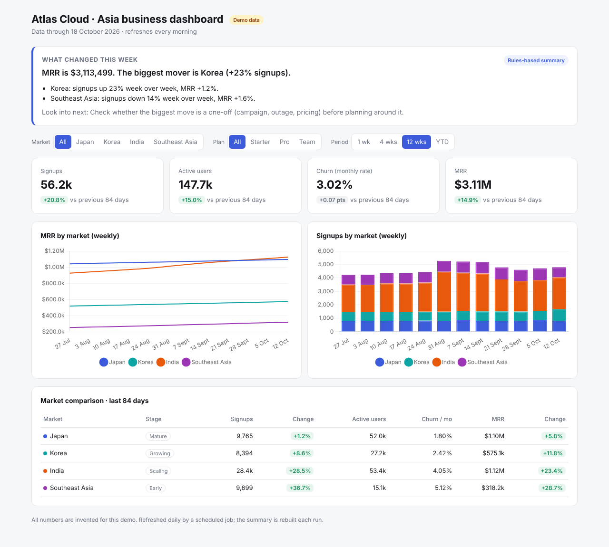

# Self-refreshing KPI dashboard with an AI weekly summary

**[Open the live dashboard →](https://theyvetteliu-commits.github.io/auto-kpi-dashboard/)**



**Context:** Leaders running several markets need one current view of the business. The report is usually rebuilt by hand, so it's slow, and it's already out of date when it lands. A single regional total also hides how differently each market is moving.

* **What I did (and why):** I built a dashboard that refreshes itself every morning and opens with an AI-written summary of what changed and why. A scheduled job pulls the data, merges it safely into the history, and the site redeploys on its own. Markets at very different stages sit side by side, so a mature market and an early one can be compared fairly.
* **Result:** The real version replaced a manual weekly leadership report, so reviews start from today's numbers instead of a spreadsheet someone rebuilt by hand.

> This repo is a public demo. The company ("Atlas Cloud") and every number are invented. The original runs on real company data that can't be shared, and this version keeps the same design.

## How it works

```
data source ──(GitHub Action, every morning)──> data.csv + summary.json committed ──> site redeploys ──> dashboard
```

| File | What it does |
|---|---|
| `index.html` | The dashboard. Loads `data.csv` and `summary.json`. No build step, no server. |
| `scripts/refresh.py` | Gets the last 14 days and merges them into `data.csv`. |
| `scripts/weekly_summary.py` | Works out the week-over-week facts in code, then has Claude write the plain-English read. |
| `scripts/demo_source.py` | Makes the invented data. In production this is replaced by `scripts/query.sql` on the data warehouse. |
| `.github/workflows/refresh.yml` | Runs both scripts daily and commits the result. |

## Design choices that came from running it for real

- **Incremental refresh.** Only the last 14 days are recomputed. A full rebuild is slow; the daily run takes a few minutes.
- **Completeness guard.** If the newest day is far below the previous week's average, the upstream data is probably still loading. That day is skipped and picked up tomorrow, instead of showing a fake drop.
- **History is never overwritten by worse data.** If a refreshed day comes back with far fewer rows than history holds, the history is kept.
- **The AI never does the maths.** Numbers are calculated in code. The model only gets the finished facts table, so it can't invent figures. If the AI call fails, a rules-based summary is written so the box is never empty.
- **No secrets in the page.** Warehouse and API keys live only as GitHub secrets.

## Run it yourself

```bash
python scripts/refresh.py            # build data.csv (demo data)
python scripts/weekly_summary.py     # build summary.json (add ANTHROPIC_API_KEY for the AI version)
python -m http.server 8000           # open http://localhost:8000
```

To publish: turn on GitHub Pages (Settings → Pages → deploy from `main`), or import the repo into Vercel. To get the AI summary in the daily run, add an `ANTHROPIC_API_KEY` repository secret.
